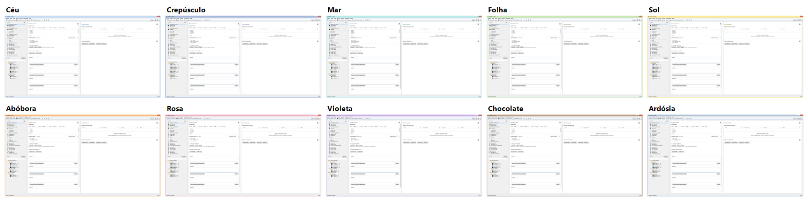

# TCPExec

Acesse e execute comandos em switches, roteadores, firewalls e servidores, um ou centenas de uma vez. / Access and run commands on switches, routers, firewalls and servers, one or hundreds at a time.

## Baixar / Download — v1.0.427

- [Instalador / Installer (.msi)](https://github.com/Dorflex-DD/TCPExec/releases/download/v1.0.427/TCPExec_v1.0.427_instalador_sem-runtime.msi)
- [Portátil / Portable (.zip)](https://github.com/Dorflex-DD/TCPExec/releases/download/v1.0.427/TCPExec_v1.0.427_executavel_sem-runtime.zip)

Windows 10/11 x64 · .NET 11

## Novidades / What's new

- Novo Modo clássico (Windows 7). / New classic mode (Windows 7).
- 10 cores de janela. / 10 window colors.
- Estilo e cor em Configurações, vale na hora. / Style and color in Settings, applied right away.
