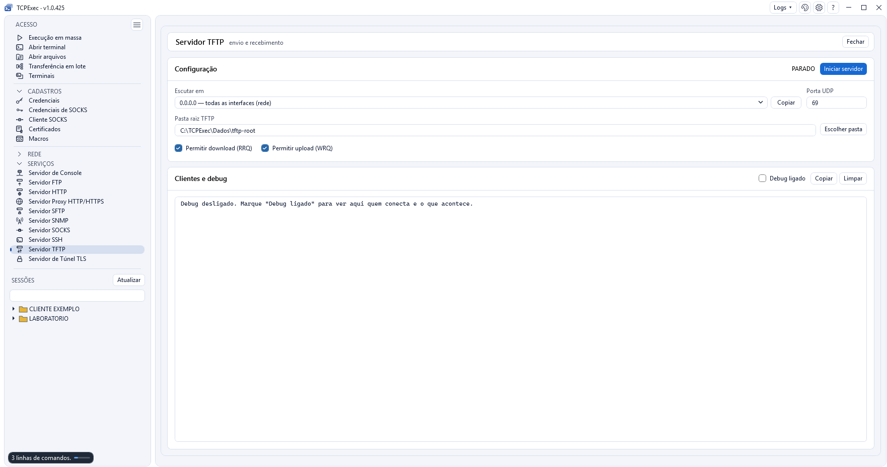
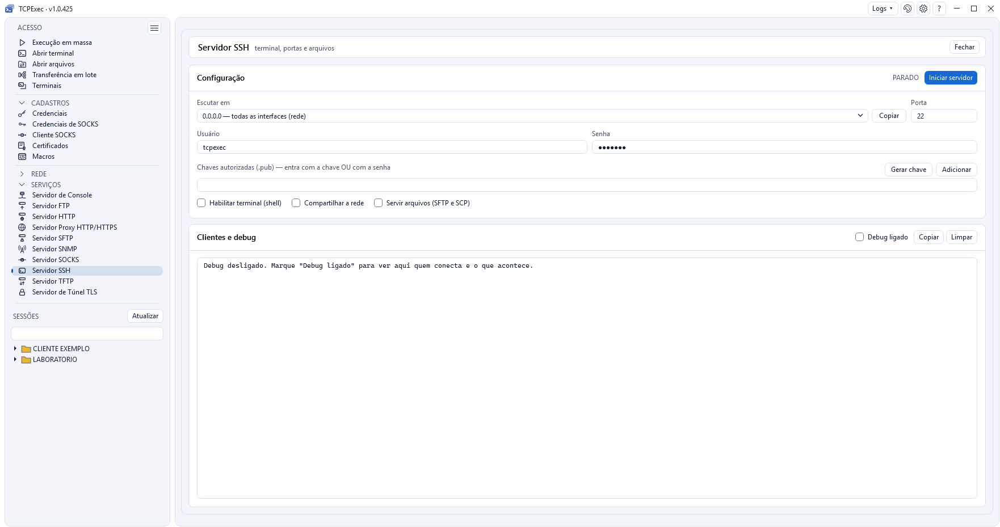

# Atualizações do TCPExec

Para atualizar manualmente o TCPExec, abra a [distribuição oficial 1.0.425](https://github.com/Dorflex-DD/TCPExec/releases/tag/v1.0.425). Escolha o instalador MSI para uma instalação Windows ou o ZIP para uma cópia portátil.

Quem já usa o TCPDesk encontra os pacotes no [canal do TCPDesk](https://github.com/Dorflex-DD/TCPDesk-releases/releases/latest).

## Telas

Execução em massa: os mesmos comandos em vários equipamentos de uma vez.

Servidores prontos: TFTP e SSH (também FTP, SFTP, HTTP, SOCKS, proxy, SNMP e console).

*Telas da versão 1.0.425, com dados fictícios.*
