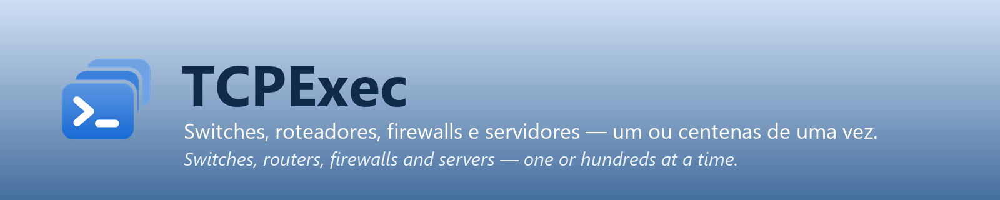
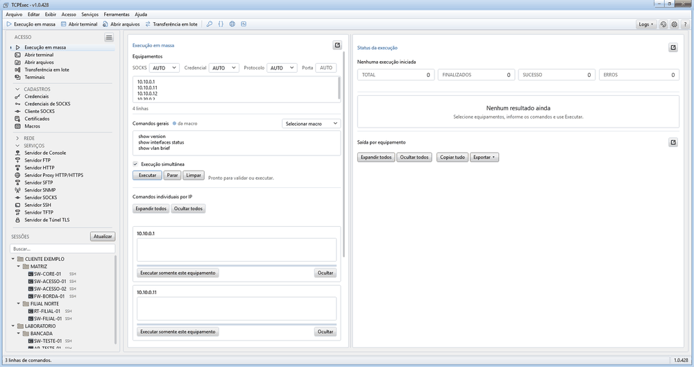
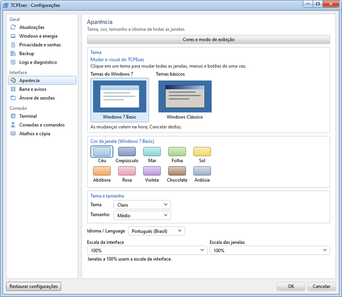
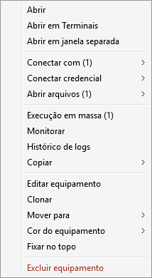
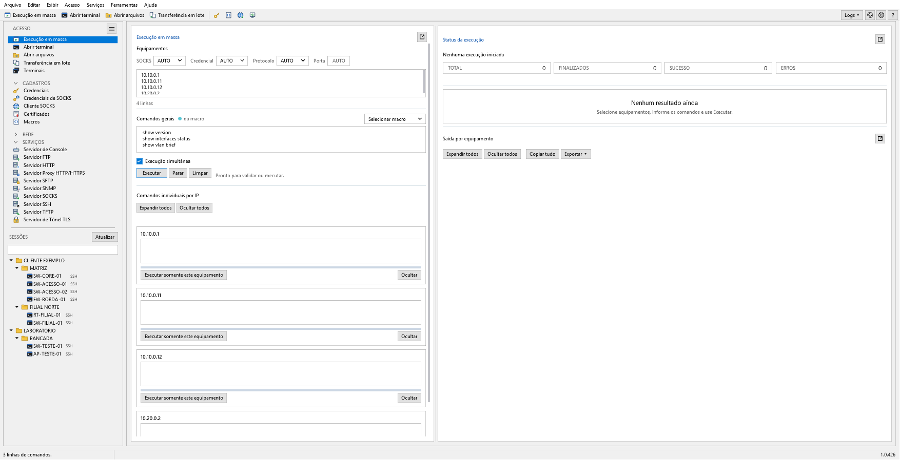
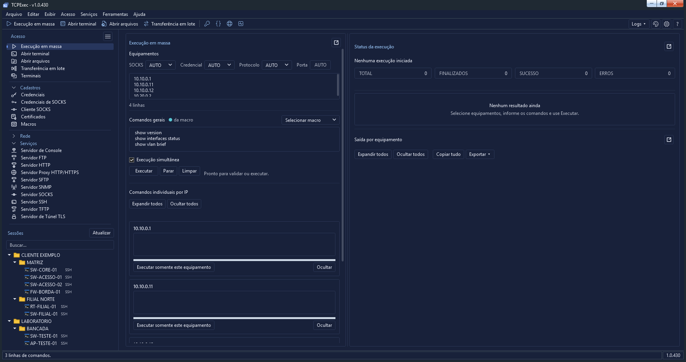
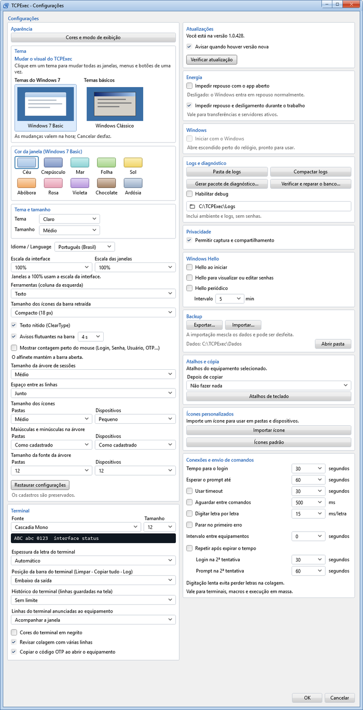
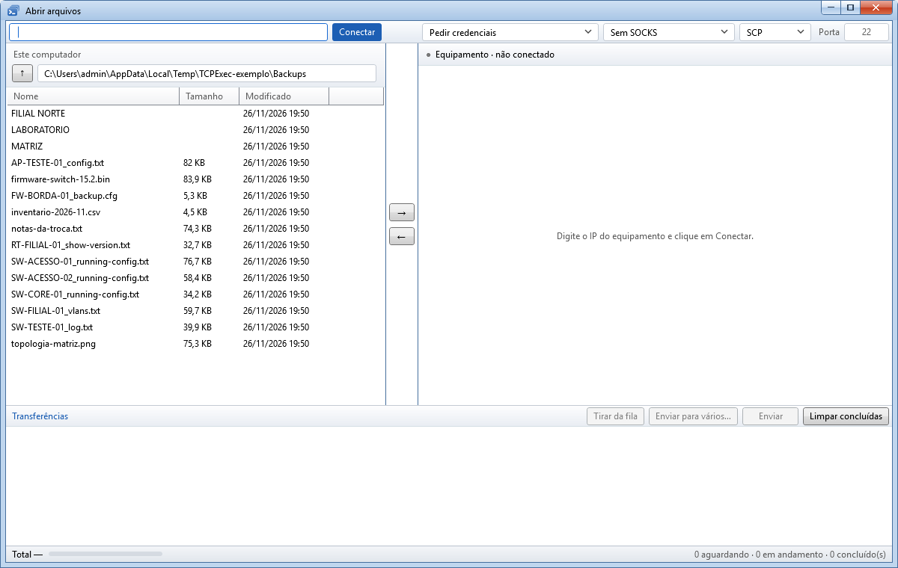
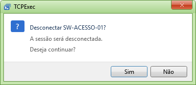

  

<b>A estação de trabalho do técnico de redes: acesse e mande comandos para um equipamento ou para centenas de uma vez.</b> <i>The network technician's workstation: access and send commands to one device or hundreds at once.</i>

## O que é / What it is
Para quem cuida de switches, roteadores, firewalls e servidores. O TCPExec guarda os equipamentos em pastas, abre SSH, Telnet, serial e RDP e executa os mesmos comandos em muitos equipamentos de uma vez. Também traz servidores prontos (FTP, TFTP, SFTP, SSH, HTTP, SOCKS).
*For people who look after switches, routers, firewalls and servers. TCPExec keeps devices in folders, opens SSH, Telnet, serial and RDP, and runs the same commands on many devices at once. It also ships ready-made servers (FTP, TFTP, SFTP, SSH, HTTP, SOCKS).*

## Destaques / Highlights
| | |
|---|---|
| **Execução em massa** — os mesmos comandos em centenas de equipamentos, com o resultado de cada um. *Mass execution — the same commands on hundreds of devices, with each result.* |  |
| **Tema Padrão ou Clássico** — 10 cores, claro ou escuro, e Configurações em páginas. *Standard or Classic theme — 10 colors, light or dark, and Settings in pages.* |  |
| **Tudo à mão no botão direito** — conectar, abrir arquivos, monitorar e copiar a partir do equipamento. *Everything on right-click — connect, open files, monitor and copy from the device.* |  |

## Como funciona / How it works
1. Instale o .msi ou abra o portátil. / *Install the .msi or open the portable version.*
2. Cadastre os equipamentos em pastas (um ou vários de uma vez). / *Add devices to folders (one or many at once).*
3. Conecte com dois cliques ou mande comandos para todos de uma vez. / *Connect with a double-click or send commands to all at once.*

## Funcionalidades / Features
| Recurso / Feature | O que faz / What it does |
|---|---|
| Terminais | SSH, Telnet, serial e RDP em abas, lado a lado ou em blocos. / *SSH, Telnet, serial and RDP in tabs, side by side or in blocks.* |
| Execução em massa | Comandos e macros em muitos equipamentos, com histórico. / *Commands and macros on many devices, with history.* |
| Servidores prontos | FTP, TFTP, SFTP, SSH, HTTP, Proxy, SOCKS, SNMP e túnel TLS. / *FTP, TFTP, SFTP, SSH, HTTP, Proxy, SOCKS, SNMP and TLS tunnel.* |
| Ferramentas | Encaminhar portas, teste HTTP, cliente SNMP, inventário e monitorar IPs. / *Port forwarding, HTTP test, SNMP client, inventory and IP monitoring.* |

## Galeria / Gallery
| | |
|---|---|
|  Tema Padrão (Céu) / *Standard theme (Sky)* |  Tema Clássico / *Classic theme* |
|  Modo escuro / *Dark mode* |  Configurações em páginas / *Settings in pages* |
|  Abrir arquivos / *Open files* |  Execução em massa / *Mass execution* |
|  Pergunta no tema (cor Folha) / *Question in the theme (Leaf color)* |  Botão direito no equipamento / *Right-click on a device* |

## Baixar / Download
- [Instalador e portátil — versão mais nova / Installer and portable — latest version](https://github.com/Dorflex-DD/TCPExec/releases/latest)

Windows 10/11 x64 · .NET 11 Desktop Runtime

## Novidades / What's new — v1.0.434
- Servidor SSH: passa a escutar só no endereço escolhido em "Escutar em" (antes ficava em todas as interfaces). / *SSH server: now listens only on the address chosen in "Listen on" (it used to listen on all interfaces).*
- Ajustes internos e de testes, sem mudança no uso. / *Internal and test adjustments, no change in use.*

Uso somente com autorização escrita do autor. / Use only with the author's written authorization.
