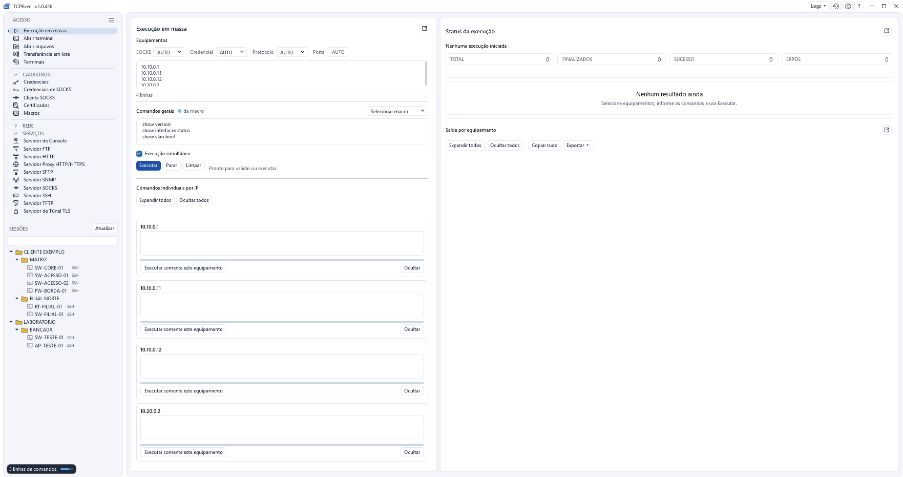
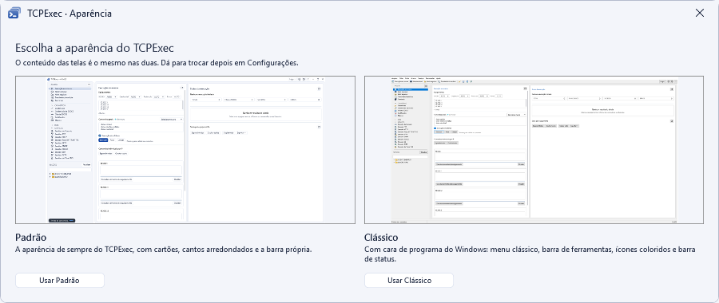

# TCPExec

Acesse e execute comandos em switches, roteadores, firewalls e servidores, um ou centenas de uma vez. / Access and run commands on switches, routers, firewalls and servers, one or hundreds at a time.

## Baixar / Download — v1.0.426

- [Instalador / Installer (.msi)](https://github.com/Dorflex-DD/TCPExec/releases/download/v1.0.426/TCPExec_v1.0.426_instalador_sem-runtime.msi)
- [Portátil / Portable (.zip)](https://github.com/Dorflex-DD/TCPExec/releases/download/v1.0.426/TCPExec_v1.0.426_executavel_sem-runtime.zip)

Windows 10/11 x64 · .NET 11

## Novidades / What's new

- Nova aparência Clássico, com cara de programa do Windows. / New Classic appearance that looks like a Windows program.
- Ao atualizar, o app pergunta: Padrão ou Clássico. / After updating, the app asks: Default or Classic.
- No Clássico, ícones coloridos, cinza ou azuis. / In Classic, colored, gray or blue icons.
